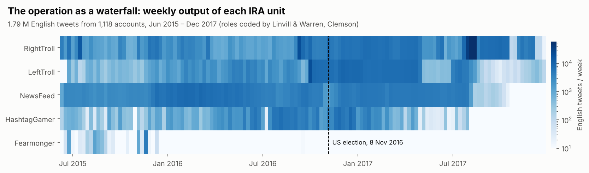
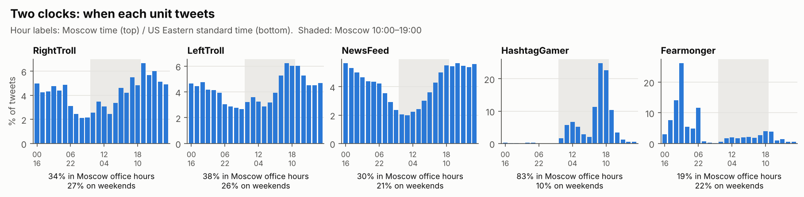
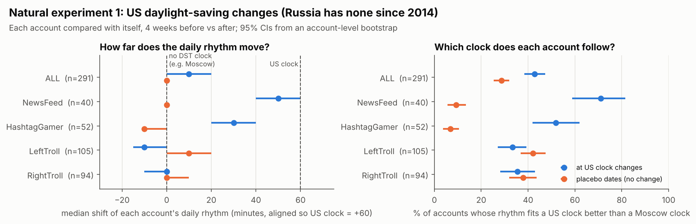
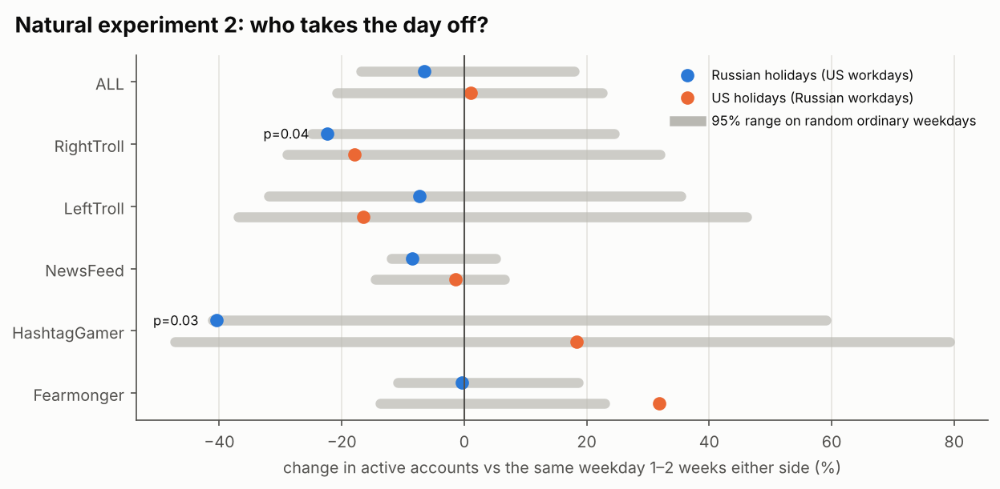
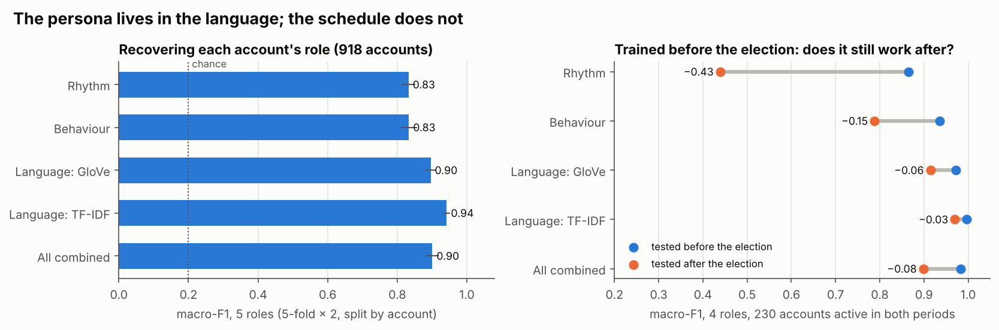
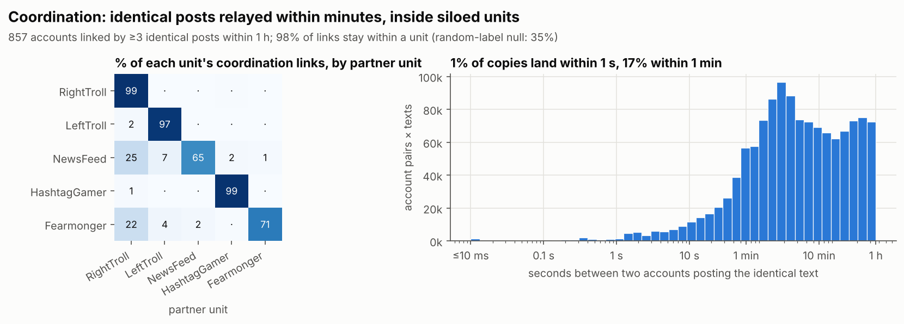

Two Clocks Forensics of a state-backed influence operation: whose clock does it run on, where does its persona live, and how does it coordinate?
The Internet Research Agency (IRA) ran thousands of Twitter accounts posing as Americans.
This project analyses 1.79 million English tweets from 1,118 IRA accounts (June 2015 – December 2017).
It asks three questions that need no authentic-user control group, because each one is
answered by the operation's own data:
Clock. The accounts claim to be American. Does their behaviour follow an American clock?
I test this with two natural experiments: US daylight-saving changes, and holidays.
Persona. The Clemson researchers coded each account into a role (RightTroll, LeftTroll,
NewsFeed, HashtagGamer, Fearmonger). Is the role carried by language or by schedule,
and which signal survives a strategic shift such as the 2016 election?
Coordination. Which accounts post identical text, how fast, and do the roles mix?

---
Findings
1. Two clocks: content timed for America, workers on Moscow time
Russia abolished daylight saving time in 2014; the US did not. Around each US clock change,
an account run on US local time should shift its daily rhythm by 60 minutes in UTC. An account
run from Moscow should not move. I compare each account with itself, four weeks before and
after each of five clock changes, and run the same test at placebo dates with no clock change.
Unit	Median rhythm shift at a US clock change (US clock = +60 min)	Accounts fitting a US clock better: real vs placebo	Reading
NewsFeed	+50 min [40, 60]	71% vs 9%	follows US time (it reposts US local news on a US schedule)
HashtagGamer	+30 min [20, 40]	52% vs 7%	mixed: the hashtag-game burst tracks US mornings
LeftTroll	−10 min [−15, 0]	33% vs 42%	does not follow US time
RightTroll	0 min [−10, 0]	36% vs 38%	does not follow US time
95% confidence intervals from an account-level bootstrap. Excluding the election-week clock
change (6 Nov 2016) leaves the NewsFeed, LeftTroll and RightTroll conclusions unchanged
and weakens HashtagGamer (28% vs 7%).
The personas that pretend to be American individuals don't live on American time.
HashtagGamer shows both clocks at once. It posts 83% of its tweets during Moscow office
hours (10:00–19:00) and only 10% on weekends, with almost nothing during US evening prime
time (0.7%). Yet its main burst moves with US clock changes. The content is scheduled for the
target audience, while the workday belongs to the workforce.


Holidays. On Russian public holidays that are ordinary US workdays, active HashtagGamer
accounts fall by 40% (p = 0.03 against random ordinary weekdays). On US holidays they don't
fall. RightTroll drops 22% on Russian holidays (p = 0.04) but also dips on US holidays, so it is
ambiguous. These p-values are uncorrected across 12 comparisons, so I treat the holiday
evidence as supporting, not conclusive. The Fearmonger unit does the opposite: activity
rises 32% on US holidays. Its top terms show why (finding 2).

2. The persona lives in the language; the schedule does not
Account-level classifiers (5-fold × 2 cross-validation, split by account, 918 accounts):
Feature family	Macro-F1 (5 roles, chance = 0.20)	Trained before the election → tested after (4 roles)
Rhythm (Moscow-time hour and weekday profile, burstiness)	0.83	0.87 → 0.44
Behaviour (retweet, link, mention and hashtag rates, audience size)	0.83	0.94 → 0.79
Language: GloVe-Twitter embeddings (SIF-weighted)	0.90	0.97 → 0.92
Language: TF-IDF	0.94	0.997 → 0.970
All combined	0.90	0.98 → 0.90
After the election, the operation reshuffled when each unit worked, and a schedule-based
classifier's score halves (0.87 → 0.44). Each persona kept its voice, so a
language-based classifier barely moves. This qualifies the hypothesis from my earlier
simulation project, Discourse-SINR, that rhythm signals survive evasion.
They do at the level of the whole operation (finding 1), but not at the level of individual
roles.
The most indicative TF-IDF terms per role match the documented operations:
Role	Top indicative terms (selection)
RightTroll	#trump2016, #makeamericagreatagain, #stopislam, #tcot, #pjnet
LeftTroll	#blacklivesmatter, #staywoke, #fergusonremembers, #blacktwitter, #policebrutality
NewsFeed	#news, #sports, county, man charged, suspect
HashtagGamer	#allwentwrongwhen, #reasoniamnotpresident, #unitedstatesin3words
Fearmonger	#kochfarms, #foodpoisoning, #turkey, #usda, thanksgiving
The Fearmonger terms are the 2015 Thanksgiving food-poisoning hoax, which explains the US
holiday spike in finding 1. Two independent methods, timing and language, point to the same
campaign.

3. Coordination: identical posts relayed within minutes, inside siloed units
Accounts are linked when they post the same normalised text at least 3 times within an hour.
That gives 857 accounts and 14,425 links.
98% of coordination links stay inside one unit, against 35% expected if role labels were
random (95% null range: 27–46%). LeftTroll and RightTroll almost never co-post, which points
to deliberate audience segmentation.
Copies are relayed, not blasted. The median gap between identical posts is 4.5 minutes;
17% land within a minute and only 1% within a second.
Label-free Louvain communities recover the roles with 82% purity (NMI 0.52). RightTroll
splits into several separate sub-units, and most Fearmonger accounts cluster with
RightTroll accounts, which suggests the hoaxes were run by the same operators.

---
Data and methods
Data. FiveThirtyEight / Clemson University archive of tweets from IRA-linked handles
that Twitter reported to the US Congress (Linvill & Warren). Downloaded automatically from
GitHub. Analysis window
19 Jun 2015 – 31 Dec 2017, English tweets, five English-facing roles.
Timestamps. The archive doesn't document its timezone. I recovered it from tweet-ID
snowflakes, which encode the true send time in milliseconds. `publish_date` is UTC for
99.99% of tweets, and every analysis uses the millisecond snowflake time.
DST test. For each account and each US clock change, I compare the post-change 10-minute
activity histogram with the account's own smoothed pre-change profile shifted by 0 or ±60
minutes (likelihood ratio), plus a free best shift within ±120 minutes. Placebo tests use
dates 8 weeks before and after each change.
Holiday test. Active accounts per day (Moscow date) relative to the median of the same
weekday 1 and 2 weeks before and after. The null is built from 20,000 random sets of ordinary
weekdays.
Language. Twitter-style normalisation; 50-d GloVe-Twitter vectors (trained on 2 B tweets;
93.9% token coverage) averaged with SIF weights; TF-IDF on word unigrams and bigrams.
Classifiers: gradient boosting (dense features) and a linear SVM (TF-IDF).
Run it
```bash
pip install -r requirements.txt
python src/run_all.py        # downloads ~1.2 GB, ~15 min on a 2-core laptop
```
`src/data.py` builds the dataset; `rhythm.py`, `roles.py` and `network.py` run the analyses;
`figures.py` redraws every figure from `results/`.
Limitations
No authentic control group. Twitter's terms prevent redistributing ordinary users'
tweets. Both natural experiments are designed to work without one, but a matched control
would sharpen the role and network results.
"Not a US clock" is not the same as "Moscow". The DST test rules out US local time. The
Moscow attribution rests on that result together with the office-hours profile and the
holiday dip, which is suggestive on its own.
The role labels are expert annotations, not ground truth. Part of what the classifiers
learn may reflect how the Clemson coders assigned roles.
Integrity note. A first version of the coordination analysis used the minute-resolution
`publish_date` and wrongly suggested near-simultaneous posting. Switching to millisecond
snowflake times corrected this to the "relayed within minutes" finding above.
Content warning. The data contains the operation's original content, including hateful
and deceptive material, and links that may lead to harmful sites.
---
Author: Zubair, PhD student, University of Malakand. Background: deep learning for RF jamming
detection. This project applies signal-forensics thinking (clocks, synchrony, interference) to
information operations.
